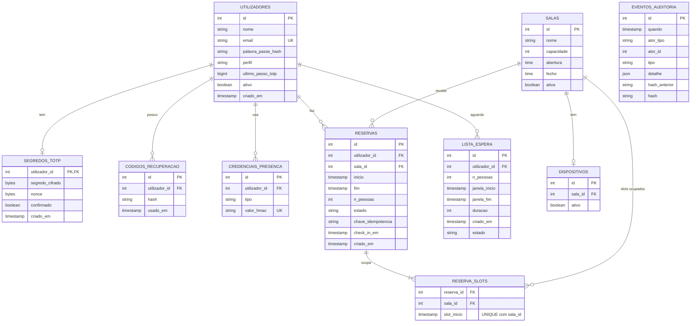

# Estrutura da base de dados — StudySpot (PostgreSQL)

## Diagrama entidade-relação

## Restrições de integridade

| Tabela | Restrições |
|---|---|
| `utilizadores` | PK `id`; `UNIQUE (email)`; `perfil` ∈ {estudante, administrador} |
| `segredos_totp` | PK/FK `utilizador_id`; o segredo só fica ativo depois de `confirmado` |
| `credenciais_presenca` | `UNIQUE (valor_hmac)`; guarda o HMAC da credencial, não o valor lido |
| `salas` | `capacidade > 0`; `abertura < fecho` |
| `dispositivos` | `UNIQUE (sala_id)` |
| `reservas` | `estado` ∈ {confirmada, concluida, cancelada, libertada}; `UNIQUE (utilizador_id, chave_idempotencia)` |
| `reserva_slots` | **`UNIQUE (sala_id, slot_inicio)`**: garante que não existem duas reservas ativas para o mesmo slot; as linhas são apagadas ao cancelar ou libertar |
| `eventos_auditoria` | Apenas acrescento; encadeamento por hash (evolução) |
