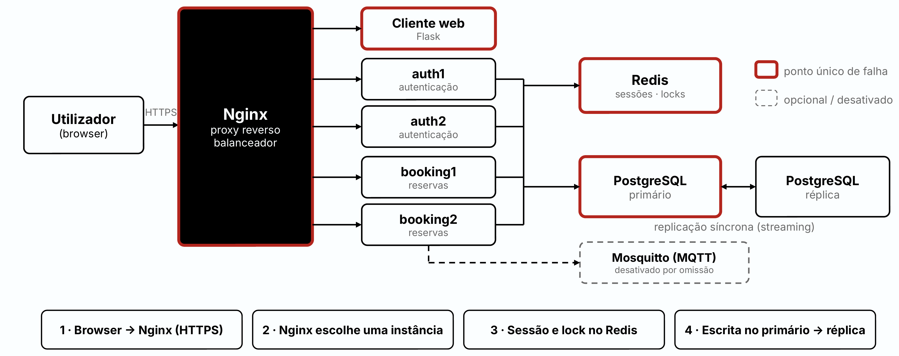

# StudySpot

Sistema distribuído de reserva de salas de estudo com autenticação de dois fatores (2FA), tolerância a faltas e validação de pedidos com IA (CSP). Projeto do 5.º semestre de Engenharia Informática (IADE – Universidade Europeia, 2026/2027), Grupo 6.



## O que tem

- Login em dois passos com palavra-passe (Argon2) e código TOTP;
- Reservas validadas por um motor CSP próprio (capacidade, horário, sobreposição e limite de 4 h por dia), com lista de espera e alternativas;
- Duas instâncias do serviço de autenticação e duas do serviço de reservas atrás de um Nginx com HTTPS;
- Redis para sessões, tentativas de login e locks; PostgreSQL com primário e réplica síncrona;
- Sem reservas duplicadas: lock no Redis + `UNIQUE (sala_id, slot_inicio)` + chave de idempotência;
- Check-in por QR Code e MQTT (desligado por omissão até à 3.ª entrega).

## Arranque rápido

```bash
cp .env.example .env        # preencher os valores (ver guia de execução)
docker compose up -d --build
```

Abrir https://localhost:8443.

## Documentação

Toda a documentação está em [`_documentacao/`](_documentacao/); o índice dos documentos técnicos está em [`_documentacao/04_documentacao_tecnica/README.md`](_documentacao/04_documentacao_tecnica/README.md).

## Equipa

Carlos Lima (20240740), Daniel Paulo (20240992), Filomeno Sabino (20241963) e Sávio Casimira (20240896).
