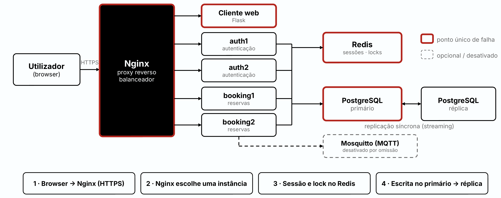

# Arquitetura do sistema — StudySpot

Atualizado na 2.ª entrega. Figuras em `02_imagens/`: `img_01.png` (proposta da 1.ª entrega) e `img_06.png` (arquitetura implementada na 2.ª entrega). Descrição completa no `Relatorio_2a_Entrega_StudySpot.pdf`, capítulo 7.

## Componentes

Todos os componentes correm em containers definidos em `docker-compose.yml`, com health checks e `restart: unless-stopped`.

| Componente | Serviço no Compose | Responsabilidade | Tecnologia | Instâncias |
|---|---|---|---|---|
| Nginx | `nginx` | Ponto de entrada, TLS, balanceamento e deteção de falhas | Nginx (alpine) | 1 |
| Cliente web | `web` | Páginas do estudante; chama as APIs pelo Nginx | Flask + Flask-Session + Gunicorn | 1 |
| Serviço de autenticação | `auth1`, `auth2` | Registo, TOTP, login em dois passos, sessões, logout | Python 3.12, FastAPI | 2 |
| Serviço de reservas | `booking1`, `booking2` | Salas, reservas, CSP, lista de espera, locks, QR e check-in | Python 3.12, FastAPI | 2 |
| PostgreSQL primário | `postgres` | Leituras e escritas de todos os serviços | PostgreSQL 18 | 1 |
| PostgreSQL réplica | `postgres-replica` | Réplica síncrona (`studyspot_replica`); não serve leituras | PostgreSQL 18 | 1 |
| Redis | `redis` | Sessões, tentativas de login, sessões do cliente web, locks | Redis 7 | 1 |
| Broker MQTT | `mosquitto` | Eventos de check-in (integração desligada por omissão) | Eclipse Mosquitto 2 | 1 |
| Dispositivo de check-in | `backend/booking_service/scripts/dispositivo_qr.py` | Simula o leitor da porta: lê o QR e publica em MQTT | Python, paho-mqtt | N (simulado) |

Serviços auxiliares, que correm uma vez no arranque e terminam:

| Serviço | Função |
|---|---|
| `postgres-replication-role` | Cria o utilizador de replicação `studyspot_replicator` no primário |
| `postgres-enable-sync` | Espera que a réplica esteja em `streaming` e ativa `synchronous_standby_names = 'FIRST 1 (studyspot_replica)'` |
| `auth-migrate` | Aplica as migrações Alembic (`database/migrations`) que criam as tabelas de autenticação; `auth1` e `auth2` só arrancam depois de terminar com sucesso |

As tabelas do serviço de reservas são criadas pelo próprio `booking1`/`booking2` no arranque (SQLAlchemy), que também semeia as 4 salas de teste (`SEMEAR_SALAS=true`).

## Portas

As portas publicadas ficam presas a `127.0.0.1`, por isso só são acessíveis a partir da própria máquina.

| Porta no anfitrião | Destino | Uso |
|---|---|---|
| 8443 | `nginx:443` | Plataforma em HTTPS (`https://localhost:8443`) |
| 8080 | `nginx:80` | Redireciona para HTTPS (308); expõe também `/health/*` para testes |
| 15432 | `postgres:5432` | pgAdmin / psql para o primário |
| 16379 | `redis:6379` | Inspeção do Redis |
| 11883 | `mosquitto:1883` | Dispositivo de check-in simulado |
| — (interna) | `nginx:8081` | Porta interna usada pelo cliente web para chamar as APIs |

## Percurso de um pedido

1. O browser liga-se ao Nginx por HTTPS;
2. O Nginx envia as páginas para o cliente web (`location /`) e as chamadas de API para `auth_pool` ou `booking_pool`;
3. O cliente web chama as APIs através do Nginx (porta interna 8081), com o token de sessão no cabeçalho `Authorization: Bearer`;
4. As instâncias consultam o Redis (sessão, locks) e escrevem no PostgreSQL primário, que só confirma depois de a réplica gravar o WAL.

O diagrama de sequência completo de uma reserva está em `02_imagens/img_07.png` e em `diagramas_uml.md`.

## Balanceamento e deteção de falhas (Nginx)

| Parâmetro | Valor | Efeito |
|---|---|---|
| `upstream auth_pool` | `auth1:8000`, `auth2:8000`, `max_fails=2 fail_timeout=10s` | Uma instância com 2 falhas fica 10 s fora do grupo |
| `upstream booking_pool` | `booking1:8000`, `booking2:8000`, `max_fails=1 fail_timeout=10s` | Uma falha basta para a excluir durante 10 s |
| `proxy_connect_timeout` | `1s` | Tempo máximo para abrir ligação a uma instância |
| `proxy_next_upstream` | `error timeout http_502 http_503 http_504` | O pedido passa à outra instância nestes casos |
| `proxy_next_upstream_tries` | `2` | No máximo duas tentativas por pedido |

A deteção é passiva: o Nginx só descobre que uma instância caiu quando um pedido falha. O Nginx não repete um POST que já tenha sido enviado a uma instância; nesse caso o cliente recebe um erro e pode repetir, e a chave de idempotência evita a reserva duplicada.

## Princípios

1. Serviços sem estado: qualquer instância atende qualquer pedido, porque a sessão vive no Redis;
2. Redundância por camada: duas instâncias de cada serviço aplicacional e réplica síncrona na base de dados;
3. Falha segura: sem garantia de correção, a operação é recusada de forma explícita (503), nunca confirmada à sorte;
4. A base de dados é a fonte de verdade da consistência; o Redis é uma otimização.

## Consistência das reservas

Lock distribuído por slot no Redis (`SET NX PX 5000`, adquirido por ordem para evitar deadlocks) + restrição `UNIQUE (sala_id, slot_inicio)` na tabela `reserva_slots` (garantia de correção) + `UNIQUE (utilizador_id, chave_idempotencia)` na tabela `reservas` (reenvios). Se a inserção violar a restrição UNIQUE, o serviço volta a pedir uma sala ao CSP, até 3 tentativas, e só depois coloca o pedido em lista de espera.

## Replicação do PostgreSQL

A réplica recebe o WAL por *streaming replication* e está configurada como síncrona. Cada COMMIT só é confirmado depois de a réplica gravar o WAL. Se a réplica parar, o COMMIT fica à espera dela (o `statement_timeout` não interrompe esta espera); o cliente web desiste ao fim de 12 s e mostra um erro, mas a transação conclui quando a réplica volta. Um novo envio do mesmo formulário usa a mesma chave de idempotência e devolve a reserva já criada.

A aplicação liga-se sempre ao primário: o encaminhamento de leituras para a réplica e o failover automático não estão implementados.

## Cliente web

O cliente web Flask não tem base de dados de utilizadores. O serviço de autenticação valida a palavra-passe e o TOTP e mantém sessões opacas no Redis; o cliente web guarda o token na sua própria sessão (Flask-Session, Redis base de dados 1) e envia-o aos serviços como `Bearer`. O token nunca chega ao browser: no browser só existe o cookie da sessão Flask, com `HttpOnly`, `Secure` e `SameSite=Lax`.

## Configuração e segredos

O Compose lê as variáveis do ficheiro `.env` na raiz do repositório (ignorado pelo Git; modelo em `.env.example`):

| Variável | Uso |
|---|---|
| `POSTGRES_USER`, `POSTGRES_PASSWORD`, `POSTGRES_DB` | Base de dados |
| `POSTGRES_REPLICATION_PASSWORD` | Palavra-passe da role de replicação (64 caracteres hexadecimais) |
| `TOTP_ENCRYPTION_KEY` | Chave AES-GCM dos segredos TOTP (64 caracteres hexadecimais) |
| `WEB_SECRET_KEY` | Chave das sessões do cliente web |
| `MQTT_ATIVO`, `TAREFA_PERIODICA_ATIVA`, `CHECKIN_SEGREDO` | Check-in e libertação (3.ª entrega; `false` por omissão) |

O certificado HTTPS fica em `.certs/studyspot.pem` e `.certs/studyspot-key.pem` (também ignorados pelo Git). Os passos para gerar estes ficheiros estão em `guia_execucao.md`.

## Pontos únicos de falha residuais

| Componente | Mitigação na versão atual | Evolução possível |
|---|---|---|
| Nginx | Reinício automático | Segundo Nginx com IP virtual |
| Cliente web | Reinício automático; sessão no Redis permite mais instâncias | Segunda instância atrás do Nginx |
| Redis | Reinício automático; falha segura (503) | Redis Sentinel, sessões na base de dados |
| Broker MQTT | Ciclo de libertação suspenso se o broker estiver em baixo | Broker redundante |
| PostgreSQL primário | Réplica síncrona; promoção manual | Failover automático (Patroni, repmgr) |
| PostgreSQL réplica | Escritas ficam pendentes, nada se perde | Segunda réplica e `ANY 1 (...)` |
