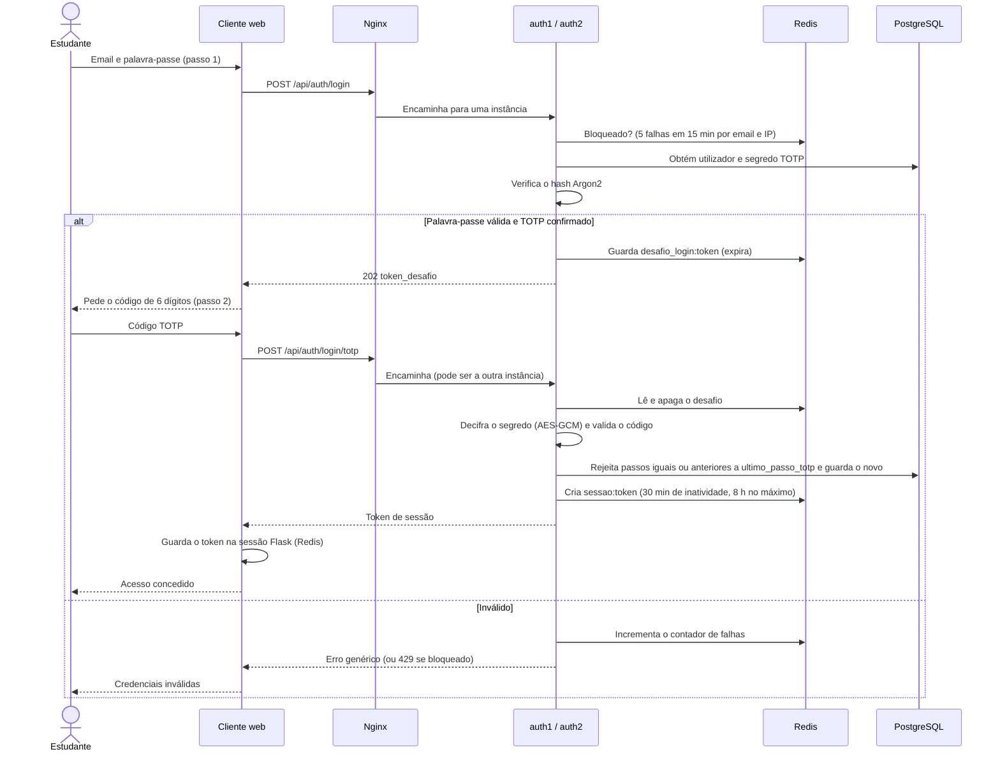
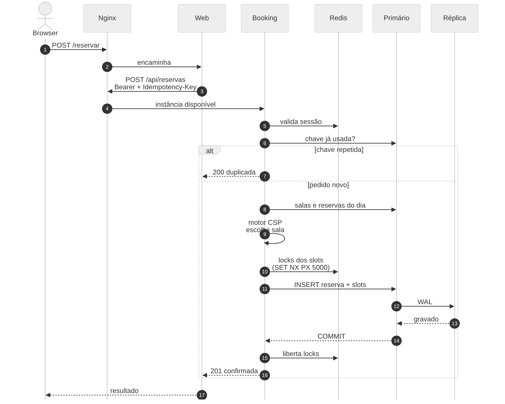
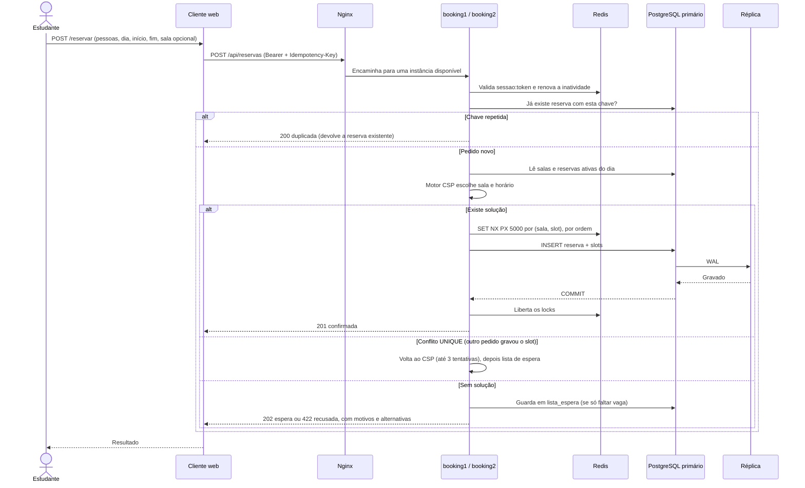
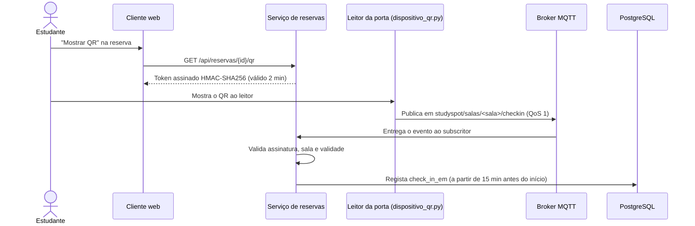
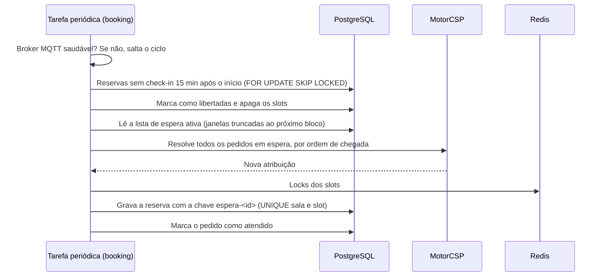

# Diagramas UML — StudySpot

Atualizado na 2.ª entrega para refletir o código implementado. As versões da 1.ª entrega estão em `02_imagens/img_02.png` a `img_05.png`; as figuras da 2.ª entrega estão em `img_06.png` (arquitetura), `img_07.png` (sequência da reserva) e `img_08.png` (modelo de dados).

## 1. Diagrama de classes

Classes de domínio (modelos SQLAlchemy) e do motor CSP (`backend/booking_service/app/csp.py`). As classes marcadas como «3.ª entrega» já existem no código, mas a funcionalidade está desligada por omissão.

```mermaid
classDiagram
    class Utilizador {
        +int id
        +string nome
        +string email
        +string palavraPasseHash
        +string perfil
        +int ultimoPassoTotp
        +bool ativo
    }
    class SegredoTOTP {
        +bytes segredoCifrado
        +bytes nonce
        +bool confirmado
    }
    class CodigoRecuperacao {
        +int id
        +string hash
        +datetime usadoEm
    }
    class Sala {
        +int id
        +string nome
        +int capacidade
        +time abertura
        +time fecho
        +bool ativa
    }
    class Reserva {
        +int id
        +int utilizadorId
        +datetime inicio
        +datetime fim
        +int nPessoas
        +string estado
        +string chaveIdempotencia
        +datetime checkInEm
    }
    class ReservaSlot {
        +int salaId
        +datetime slotInicio
    }
    class ListaEspera {
        +int id
        +int utilizadorId
        +int nPessoas
        +datetime janelaInicio
        +datetime janelaFim
        +int duracao
        +string estado
    }
    class Dispositivo {
        +int id
        +bool ativo
    }
    class MotorCSP {
        +ConfigCSP cfg
        +resolver(pedidos, salas, reservasFixas) Resolucao
        +validar(pedido, sala, reservas) Resultado
        +sugerirAlternativas(pedido, salas, reservas) Alternativas
    }
    class ConfigCSP {
        +int slotMinutos = 30
        +float limiteDiarioHoras = 4.0
        +string estrategia = "fifo"
    }
    class Resolucao {
        +dict atribuicoes
        +dict horarios
        +dict rejeitados
        +list listaEspera
    }

    Utilizador "1" --> "0..1" SegredoTOTP : tem
    Utilizador "1" --> "0..*" CodigoRecuperacao : tem
    Utilizador "1" ..> "0..*" Reserva : faz (referência lógica)
    Utilizador "1" ..> "0..*" ListaEspera : aguarda (referência lógica)
    Sala "1" --> "0..*" Reserva : recebe
    Sala "1" --> "0..1" Dispositivo : tem à porta «3.ª entrega»
    Reserva "1" --> "1..*" ReservaSlot : ocupa
    Sala "1" --> "0..*" ReservaSlot : slots ocupados
    MotorCSP --> ConfigCSP
    MotorCSP ..> Resolucao : devolve
    MotorCSP ..> Reserva : atribui
    MotorCSP ..> ListaEspera : reavalia
    note for ReservaSlot "UNIQUE (sala_id, slot_inicio)"
    note for Reserva "UNIQUE (utilizador_id, chave_idempotencia)"
```

A auditoria (`EventoAuditoria`) prevista na 1.ª entrega ainda não está implementada.

## 2. Sequência: login com 2FA

O login tem dois passos. O primeiro valida a palavra-passe e devolve um desafio guardado no Redis; o segundo valida o código TOTP e cria a sessão.

## 3. Sequência: pedido de reserva

Respostas possíveis: 201 confirmada, 200 duplicada, 202 espera, 422 recusada, 409 slot bloqueado por outro pedido em curso, 503 Redis indisponível.

## 4. Sequência: check-in por QR Code «3.ª entrega»

Código e testes prontos; ativado com `MQTT_ATIVO=true` e `CHECKIN_SEGREDO`.

## 5. Sequência: libertação automática e realocação «3.ª entrega»

Ativada com `TAREFA_PERIODICA_ATIVA=true`; corre a cada 60 s em cada instância de reservas.

O `FOR UPDATE SKIP LOCKED` permite que as duas instâncias corram o ciclo ao mesmo tempo sem libertar a mesma reserva duas vezes, e a chave `espera-<id>` impede que repetir o ciclo duplique reservas.
