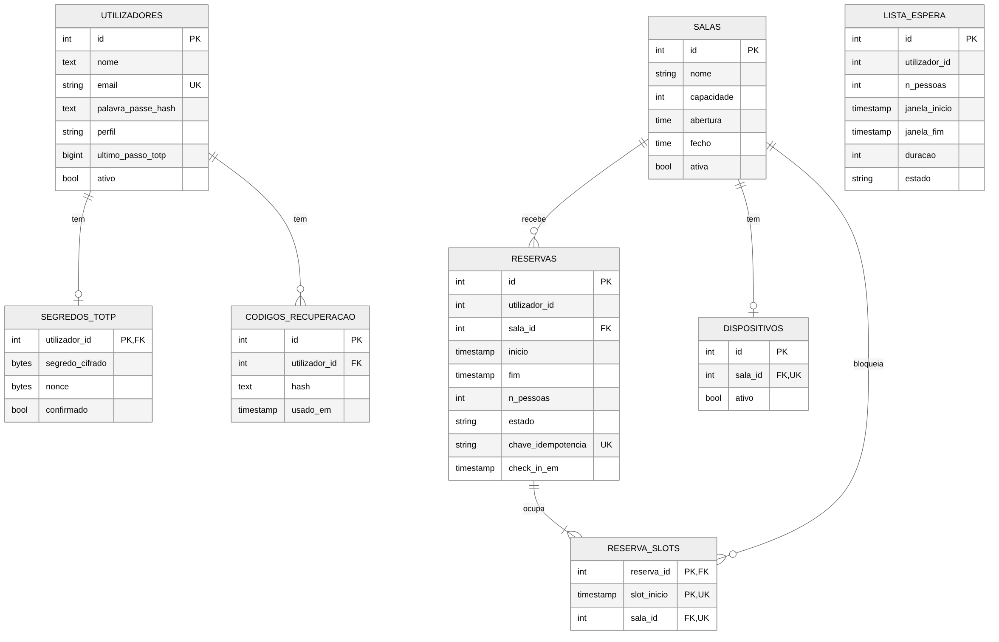
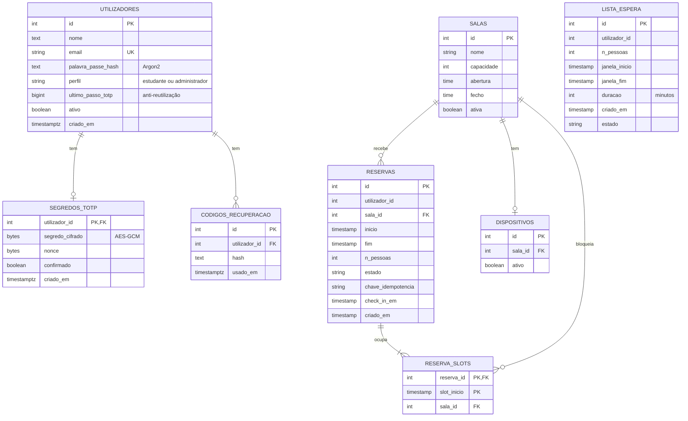

# Estrutura da base de dados — StudySpot (PostgreSQL)

Atualizado na 2.ª entrega. O modelo descrito aqui é o que o código cria e usa. Figura: `02_imagens/img_08.png`.

## Onde é criado cada grupo de tabelas

| Tabelas | Serviço dono | Como são criadas |
|---|---|---|
| `utilizadores`, `segredos_totp`, `codigos_recuperacao` | Autenticação | Migrações Alembic em `database/migrations/versions/`, aplicadas pelo serviço `auth-migrate` antes de `auth1`/`auth2` arrancarem |
| `salas`, `reservas`, `reserva_slots`, `lista_espera`, `dispositivos` | Reservas | `criar_tabelas()` (SQLAlchemy) no arranque de `booking1`/`booking2`; com `SEMEAR_SALAS=true` são criadas 4 salas de teste |

Cada serviço gere as suas próprias tabelas na mesma base de dados. Por isso, `reservas.utilizador_id` e `lista_espera.utilizador_id` são referências lógicas ao utilizador, sem chave estrangeira entre serviços.

O ficheiro `database/schema.sql` é um *dump* do esquema de referência desenhado na 1.ª entrega (inclui `credenciais_presenca` e `eventos_auditoria`). Não é usado pelo arranque dos serviços e tem diferenças de nomes face aos modelos do código, por isso não deve ser carregado na base de dados da aplicação; serve como referência para as tabelas ainda por implementar.

## Diagrama entidade-relação

## Restrições de integridade

| Tabela | Restrições |
|---|---|
| `utilizadores` | PK `id`; `UNIQUE (email)`; `CHECK perfil IN ('estudante', 'administrador')` |
| `segredos_totp` | PK/FK `utilizador_id`; o segredo só fica ativo depois de `confirmado` |
| `codigos_recuperacao` | FK `utilizador_id`; guarda apenas o hash do código. A tabela já existe, mas ainda não há rota que gere ou aceite códigos de recuperação |
| `salas` | `CHECK capacidade > 0`; `CHECK abertura < fecho` |
| `dispositivos` | `UNIQUE (sala_id)`: no máximo um leitor por sala |
| `reservas` | `CHECK estado IN ('confirmada', 'concluida', 'cancelada', 'libertada')`; `CHECK inicio < fim`; `CHECK n_pessoas > 0`; **`UNIQUE (utilizador_id, chave_idempotencia)`**; índice `(sala_id, inicio)` |
| `reserva_slots` | PK `(reserva_id, slot_inicio)`; **`UNIQUE (sala_id, slot_inicio)`**: nunca existem duas reservas ativas para a mesma sala e o mesmo bloco de 30 min; as linhas são apagadas ao cancelar ou libertar (`ON DELETE CASCADE` a partir de `reservas`) |
| `lista_espera` | `CHECK estado IN ('ativa', 'atendida', 'expirada')`; `CHECK janela_inicio < janela_fim`; `CHECK duracao > 0`; `CHECK n_pessoas > 0` |

## Estados

| Entidade | Estado | Significado |
|---|---|---|
| Reserva | `confirmada` | Gravada e com os slots ocupados |
| Reserva | `concluida` | Previsto para reservas terminadas; o código ainda não atribui este estado |
| Reserva | `cancelada` | Cancelada pelo estudante; slots libertados |
| Reserva | `libertada` | Sem check-in no prazo (3.ª entrega); slots libertados |
| Espera | `ativa` | À espera de vaga |
| Espera | `atendida` | Recebeu uma reserva na realocação |
| Espera | `expirada` | A janela pedida já passou |

## Replicação

Todas as tabelas são replicadas para `postgres-replica` por *streaming replication* síncrona. A réplica está em modo de recuperação (`pg_is_in_recovery() = t`) e não aceita escritas. Para consultar os dados no pgAdmin, usar o primário em `localhost:15432` (ver `guia_execucao.md`).

## Por implementar

| Tabela | Finalidade | Entrega |
|---|---|---|
| `eventos_auditoria` | Registo só de acrescento, com encadeamento por hash | 3.ª |
| `credenciais_presenca` | Credenciais RFID guardadas como HMAC | Só se for usado RFID além do QR Code |
