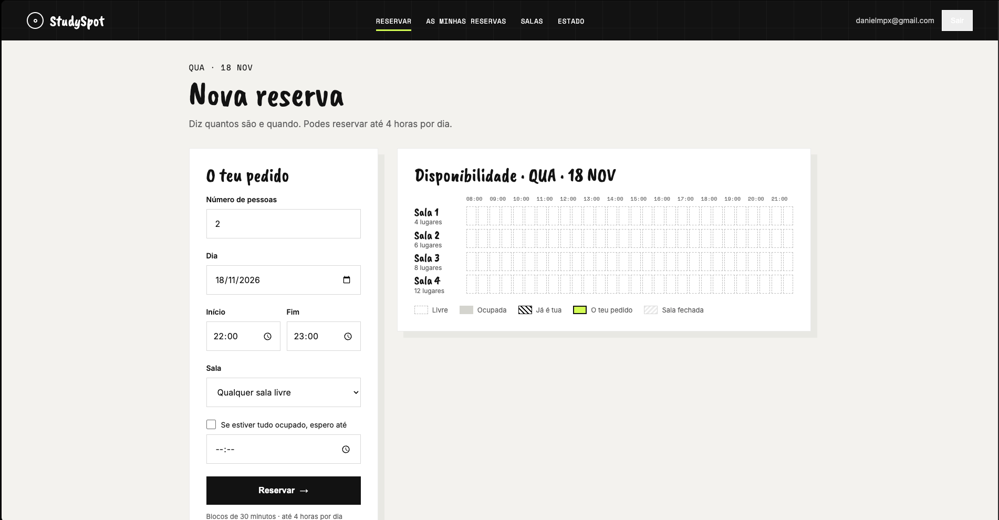
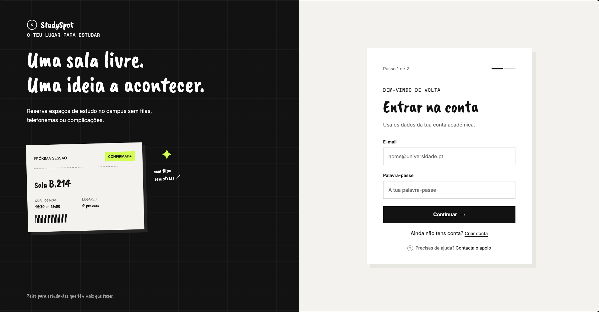
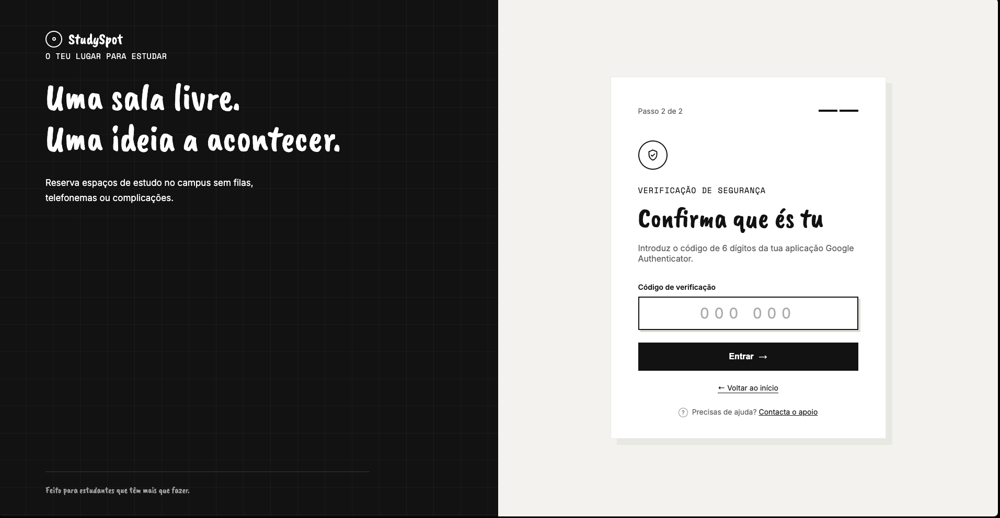
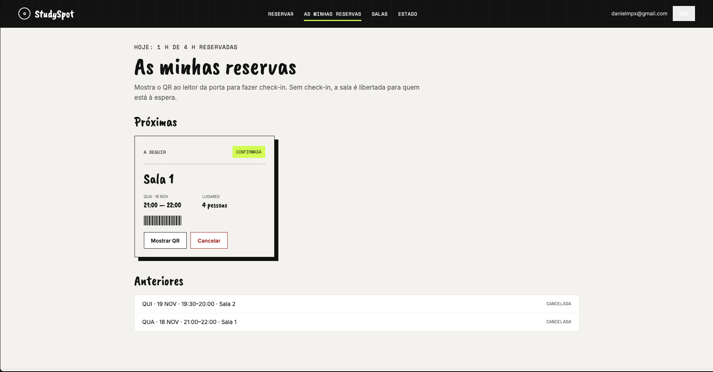
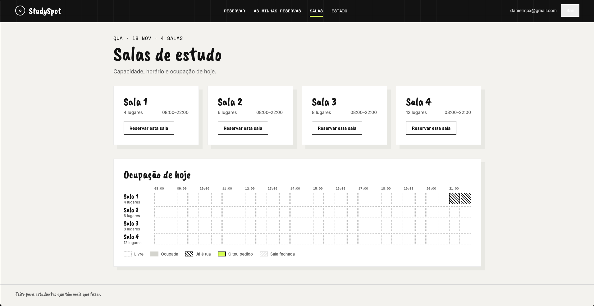
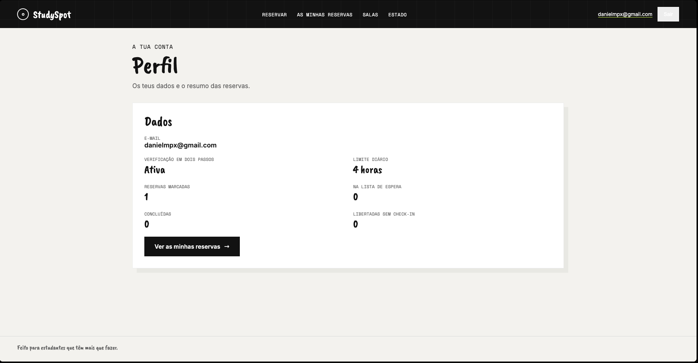

# Interface web — StudySpot

O cliente web (`frontend/web_client/`) é uma aplicação Flask com páginas geradas no servidor (templates Jinja em `templates/`) e estilos próprios em `static/`. Foi desenhado a partir das propostas de wireframe em `Wireframes_StudySpot.pdf`: a versão implementada segue a **Proposta 1 · Caderno** (formulário à esquerda e grelha de disponibilidade à direita), com a identidade visual dos slides (títulos em marcador, fundo papel, verde-lima para o pedido do estudante).

## Princípios

- **Só os campos de que o CSP precisa:** pessoas, dia, início, fim, sala opcional e janela de espera;
- **Explicar a decisão:** quando um pedido é recusado, a página mostra o motivo em linguagem simples e as alternativas;
- **Legenda que não depende só da cor:** livre (tracejado), ocupada (cinzento), já é tua (riscado), o teu pedido (verde), sala fechada (riscado claro);
- **O token de sessão nunca chega ao browser:** fica na sessão Flask, guardada no Redis.

## Páginas

| Rota | Página | Captura |
|---|---|---|
| `/registo`, `/registo/2fa` | Criar conta e configurar o TOTP com um QR Code | `02_imagens/img_11.png` |
| `/login` | Entrar, passo 1: email e palavra-passe | `02_imagens/img_09.png` |
| `/verificar` | Entrar, passo 2: código de 6 dígitos do Google Authenticator | `02_imagens/img_10.png` |
| `/reservar` | Nova reserva: formulário e grelha de disponibilidade do dia | `02_imagens/img_12.png` |
| `/reservas` | As minhas reservas: próximas (com QR e cancelar), anteriores e lista de espera | `02_imagens/img_13.png` |
| `/salas` | Salas de estudo: capacidade, horário e ocupação de hoje | `02_imagens/img_14.png` |
| `/perfil` | Perfil: email, estado do 2FA, limite diário e resumo das reservas | `02_imagens/img_15.png` |
| `/estado` | Estado: se os serviços respondem e se a base de dados e o Redis estão prontos | — |
| `/reservas/<id>/qr` | QR Code de check-in da reserva | — |

### Criar conta e configurar o TOTP

O registo começa com o nome, o e-mail académico e a palavra-passe. Depois, a pessoa configura o TOTP ao ler o QR Code com a aplicação autenticadora e confirma a configuração com o primeiro código válido.

### Entrar (dois passos)

O primeiro passo envia a palavra-passe ao serviço de autenticação, que devolve um desafio; o segundo envia o código TOTP e cria a sessão. A mensagem de erro é sempre genérica, para não revelar se o email existe.

### Nova reserva

O formulário recolhe o pedido e a grelha mostra todas as salas do dia em blocos de 30 minutos. Ao submeter, o serviço de reservas corre o CSP: se houver vaga, escolhe a sala mais pequena que serve; se não houver, a página mostra o motivo e as alternativas, e, com a opção "Se estiver tudo ocupado, espero até", o pedido fica em lista de espera. O formulário leva uma chave de idempotência num campo oculto, por isso submetê-lo duas vezes não cria duas reservas.

### As minhas reservas

Mostra as horas já reservadas no dia face ao limite de 4 horas, as próximas reservas com os botões "Mostrar QR" e "Cancelar", e o histórico com o estado de cada reserva.

### Salas

### Perfil

## Mensagens perante falhas

| Situação | Comportamento da interface |
|---|---|
| Serviço indisponível (503) ou Redis em baixo | Página de indisponibilidade temporária, com indicação para tentar dentro de instantes |
| Timeout ao reservar (ex.: réplica parada) | Aviso de que a reserva não foi confirmada; o estudante confirma em "As minhas reservas" antes de tentar outra vez |
| Sessão expirada | Regresso à página de login |
| Pedido recusado pelo CSP | Motivo (capacidade, horário, sobreposição ou limite diário) e alternativas |
| Demasiadas tentativas de login | Indicação para tentar dentro de 15 minutos |

## Wireframes

O ficheiro `Wireframes_StudySpot.pdf` contém quatro propostas: 1 · Caderno (implementada), 2 · Campus (painel com menu lateral), 3 · Planta (mapa do piso; exigiria a posição de cada sala na base de dados) e 4 · Passo a passo (telemóvel, uma pergunta por ecrã). Os elementos das outras propostas que podem ser reaproveitados na 3.ª entrega são o resumo do dia com o QR (Proposta 2) e a desativação antecipada de opções impossíveis (Proposta 4).
