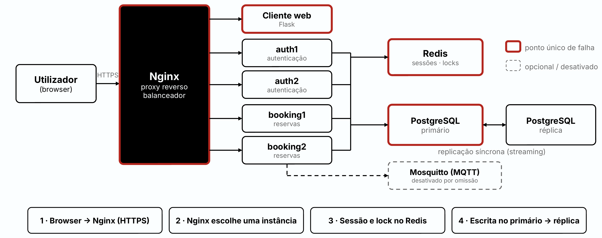

# Modelo de Faltas – StudySpot

Atualizado na 2.ª entrega com o comportamento observado no protótipo. O procedimento passo a passo para executar os ensaios locais está no [Guião de teste de tolerância a falhas](./guiao_teste_tolerancia_falhas.md).

## 1. Objetivo

O presente documento define o modelo de faltas do sistema de reserva de salas de estudo: os componentes que podem falhar, os tipos de falha considerados, o número de falhas simultâneas que o sistema suporta, os mecanismos de deteção e recuperação e a informação que pode ou não ser perdida.

Na 1.ª entrega, este modelo fixou as garantias pretendidas. Na 2.ª entrega, foi implementado e validado com falhas provocadas, parando containers com o sistema em funcionamento. As diferenças entre o previsto e o observado estão assinaladas.

Considera-se um modelo de faltas por paragem (*crash*): um componente deixa de responder, mas não envia respostas incorretas. Falhas bizantinas e ataques ficam fora deste modelo e são tratados no modelo de ameaças (`seguranca_informatica.md`).

## 2. Visão geral da arquitetura

- **Cliente web** (`web`): Flask + Gunicorn, uma instância;
- **Nginx** (`nginx`): proxy reverso, TLS e balanceador, uma instância;
- **Serviço de autenticação** (`auth1`, `auth2`): registo, login, 2FA (TOTP), sessões;
- **Serviço de reservas** (`booking1`, `booking2`): salas, CSP, reservas, lista de espera, check-in;
- **PostgreSQL** (`postgres` primário e `postgres-replica` réplica síncrona);
- **Redis** (`redis`): sessões, tentativas de login e locks distribuídos;
- **Broker MQTT** (`mosquitto`): eventos de check-in (integração desligada por omissão na 2.ª entrega).

Todos os componentes correm em containers Docker, geridos com Docker Compose, com `restart: unless-stopped`.

## 3. Componentes suscetíveis a falhas

| Componente | Função | Risco principal |
|---|---|---|
| Cliente web | Interface do utilizador | Indisponibilidade da interface (instância única) |
| Nginx | Distribui tráfego pelas instâncias | Ponto único de falha |
| Serviço de autenticação | Login e 2FA | Indisponibilidade de uma instância |
| Serviço de reservas | Reservas e CSP | Indisponibilidade de uma instância; falha a meio de um POST |
| PostgreSQL primário | Armazenamento persistente | Indisponibilidade total das leituras e escritas |
| PostgreSQL réplica | Cópia síncrona | Bloqueio das escritas enquanto estiver parada |
| Redis | Sessões, tentativas e locks | Perda das sessões ativas e dos locks em curso |
| Broker MQTT | Eventos de check-in | Perda de eventos de check-in |
| Containers Docker | Execução de cada serviço | Crash do processo, reinício inesperado |

## 4. Tipos de falhas consideradas

### 4.1. Falha de um container

Um container pode parar por erro da aplicação, encerramento inesperado ou falta de recursos. A política `unless-stopped` volta a arrancá-lo, exceto quando é parado de propósito com `docker compose stop`.

### 4.2. Falha de uma instância de serviço

Uma instância do serviço de autenticação ou de reservas pode ficar indisponível ou deixar de responder. O Nginx deteta a falha no primeiro pedido que falha e passa a usar a outra instância.

### 4.3. Falha do PostgreSQL primário

Se o primário ficar indisponível, os serviços perdem o acesso à base de dados: leituras e escritas falham e o `/health/ready` dos serviços devolve 503. A réplica não assume o papel de primário nem serve leituras aos serviços; é necessária a promoção manual da réplica e a alteração do destino das ligações. Não existe failover automático.

### 4.4. Falha da réplica

Com a réplica parada, o primário continua a servir leituras. Cada escrita (COMMIT) fica à espera da confirmação da réplica, porque a replicação é síncrona; esta espera não é interrompida pelo `statement_timeout`. O cliente web desiste ao fim de 12 segundos e informa o utilizador de que a reserva não foi confirmada, mas a transação continua pendente no primário e conclui quando a réplica volta.

> **Diferença face à 1.ª entrega:** estava previsto que as escritas terminassem com erro 503 ao fim de cinco segundos. No protótipo, o PostgreSQL mantém a transação à espera; quem desiste é o cliente, aos 12 segundos. Nenhuma escrita é confirmada sem a réplica, e nada se perde.

### 4.5. Falha do Redis

Sem Redis não há sessões, contadores de tentativas nem locks. O login e a criação de reservas falham de forma segura (503), e o cliente web mostra uma mensagem de indisponibilidade. As reservas já gravadas no PostgreSQL não são afetadas.

### 4.6. Falha de comunicação

Pode ocorrer interrupção temporária de comunicação entre dois componentes (por exemplo, serviço de reservas e PostgreSQL, ou Nginx e uma instância). Do ponto de vista do modelo, é tratada como uma paragem do componente remoto.

### 4.7. Falha do broker MQTT

O broker pode ficar indisponível, impedindo a receção de eventos de check-in. Nesse caso, o ciclo de libertação automática é saltado, para não libertar salas de estudantes que apenas não conseguiram fazer check-in (3.ª entrega).

### 4.8. Perda temporária de conectividade

Um componente pode permanecer ativo, mas inacessível, devido a problemas de rede. Os timeouts (secção 7) transformam esta situação numa falha detetável.

## 5. Número de falhas simultâneas suportadas

O sistema suporta a falha de **um componente de cada tipo de cada vez**, desde que exista redundância para esse componente:

- 1 instância do **serviço de autenticação** em baixo: a outra assume;
- 1 instância do **serviço de reservas** em baixo: a outra assume;
- a **réplica do PostgreSQL** em baixo: leituras continuam; escritas ficam pendentes até a réplica voltar, sem perda de dados.

**Não é suportada**, nesta versão, a falha simultânea de todas as instâncias do mesmo serviço, a falha do primário do PostgreSQL (exige intervenção manual), nem a falha do Redis, do Nginx ou do cliente web, que são instâncias únicas.

## 6. Funcionalidades que permanecem disponíveis

| Falha | Funcionalidades que continuam disponíveis | Funcionalidades afetadas |
|---|---|---|
| 1 instância de autenticação | Login, registo e verificação 2FA, via a outra instância | Possível atraso de cerca de 1 s no primeiro pedido |
| 1 instância de reservas | Consulta e criação de reservas, via a outra instância | Um POST em curso na instância que caiu devolve erro; pode ser repetido sem duplicar |
| Réplica PostgreSQL | Todas as leituras (consultar salas, reservas, perfil) | Escritas (reservar, cancelar, registar) ficam pendentes até a réplica voltar |
| PostgreSQL primário | Página de estado | Todas as operações com dados, até à recuperação manual |
| Redis | Dados persistentes intactos | Login, sessões ativas e criação de reservas, até ao reinício |
| Nginx | — | Plataforma inacessível até ao reinício |
| Cliente web | APIs continuam a responder | Interface inacessível até ao reinício |
| Broker MQTT | Reservas e login continuam a funcionar | Check-in e libertação automática suspensos (3.ª entrega) |

O sistema privilegia, sempre que uma operação não possa ser confirmada com garantias suficientes, **recusar a operação de forma explícita** em vez de arriscar um estado inconsistente: sem lock no Redis ou sem escrita confirmada no PostgreSQL, a reserva não é confirmada.

## 7. Deteção de falhas

| Mecanismo | Onde | Detalhe |
|---|---|---|
| Health check do Docker | auth, booking, PostgreSQL, Redis, Mosquitto | `GET /health/live` a cada 10 s nos serviços aplicacionais; `pg_isready`, `redis-cli ping` e `mosquitto_sub` a cada 5 s. O Nginx e o cliente web não têm health check |
| Deteção passiva no Nginx | `auth_pool`, `booking_pool` | `max_fails` (2 em auth, 1 em reservas), `fail_timeout=10s`, `proxy_connect_timeout 1s`, `proxy_next_upstream` em erro, timeout, 502, 503 e 504 |
| Readiness | `/health/ready` | Verifica PostgreSQL e Redis; devolve 503 se algum falhar |
| Timeouts no cliente web | Chamadas às APIs | 5 s para a autenticação e 12 s para as reservas |
| Erros de dependência | Serviços | Erros de Redis e de PostgreSQL são convertidos em 503 com mensagem simples |
| Estado do broker | Tarefa periódica | Se o subscritor MQTT não estiver ligado, o ciclo de libertação é saltado |
| Página de estado | Cliente web (`/estado`) | Mostra se os serviços respondem e se a base de dados e o Redis estão prontos |
| Logs | `docker compose logs` | Registo dos pedidos e das falhas por serviço |

## 8. Recuperação e substituição

- **Reinício automático do container** (`unless-stopped`) para todos os serviços de longa duração;
- **Reintegração no Nginx**: passados os 10 s de `fail_timeout`, a instância recuperada volta a receber pedidos;
- **Re-sincronização da réplica**: ao voltar a arrancar, a réplica retoma o *streaming* a partir do ponto em que parou e o primário volta a mostrá-la como `sync`;
- **Promoção do primário**: manual nesta fase (promover a réplica com `pg_promote()` e alterar o destino das ligações dos serviços); não há failover automático;
- **Redis**: após o reinício, os serviços voltam a ligar-se; as sessões perdidas obrigam a novo login.

## 9. Perda de informação possível

A integridade dos dados é um requisito central, especialmente para reservas confirmadas. A situação a evitar é:

> O utilizador submete uma reserva → o sistema indica que foi confirmada → ocorre uma falha → a reserva não fica persistida.

Para prevenir isto:

- Uma reserva só é confirmada ao utilizador depois de o COMMIT ser confirmado pelo primário e pela réplica;
- Cada pedido de reserva leva uma **chave de idempotência** (`Idempotency-Key`), gerada pelo cliente web e guardada num campo oculto do formulário. Um reenvio, por timeout ou por o utilizador carregar outra vez, devolve a reserva já criada (200) em vez de criar outra;
- Com a réplica parada, a reserva pode ficar pendente e aparecer depois; o estudante confirma em "As minhas reservas" antes de tentar outra vez.

**Não podem ser perdidos:** reservas confirmadas, dados dos utilizadores, segredos TOTP. **Podem ser perdidos sem impacto crítico:** sessões ativas (novo login), locks em curso (a restrição UNIQUE mantém a correção), formulários por submeter.

## 10. Consistência de dados

**PostgreSQL:** a réplica recebe o WAL por *streaming* síncrono (`synchronous_standby_names = 'FIRST 1 (studyspot_replica)'`). O primário só confirma uma transação depois de a réplica gravar o respetivo WAL, por isso uma transação confirmada pode ser recuperada promovendo a réplica. A replicação não substitui backups.

**Redis:** o lock distribuído reduz a contenção, mas não é a garantia de correção: um lock com expiração pode perder-se ou expirar a meio da operação. A garantia é a restrição `UNIQUE (sala_id, slot_inicio)` na tabela `reserva_slots`: mesmo que o lock falhe, a base de dados rejeita o slot duplicado, e o serviço volta a pedir uma sala ao CSP.

Esta combinação (lock + UNIQUE + idempotência) garante que não existe inconsistência entre o que o sistema mostra como reservado e o que está na base de dados, mesmo com pedidos simultâneos em instâncias diferentes.

## 11. Falhas do ponto de vista do utilizador

O cliente web é Flask + Gunicorn, com a sessão no Redis (não num cookie com os dados de autenticação). Existe uma instância; se forem adicionadas mais, todas devem usar o mesmo Redis e a mesma `WEB_SECRET_KEY`, sem necessidade de afinidade de sessão.

| Situação | Comportamento |
|---|---|
| Um serviço devolve 503 | Mensagem simples de indisponibilidade temporária, com sugestão de tentar dentro de instantes |
| Timeout ao criar reserva (ex.: réplica parada) | Mensagem de que a reserva não foi confirmada; repetir o mesmo formulário não duplica |
| Perda de sessão | Reencaminhamento para o login |
| Reserva recusada | Motivo em linguagem simples e alternativas (outras salas e até três horários) |
| Horário ocupado | Opção de ficar em lista de espera até uma hora indicada |

As mensagens seguem três princípios: linguagem simples, explicação do que aconteceu e indicação do próximo passo. O erro técnico continua registado nos logs.

## 12. Cenários de teste e resultados da 2.ª entrega

| ID | Cenário | Resultado esperado | Como foi verificado |
|---|---|---|---|
| D1 | Parar `auth1` e iniciar sessão | Login funciona através de `auth2` | Demonstração ao vivo |
| D2 | Parar `booking1` e criar reserva | Reserva criada através de `booking2` | Demonstração ao vivo |
| D3 | Dois pedidos simultâneos para a mesma sala e slot | Um confirmado (201), o outro em espera (202) ou noutra sala | Demonstração ao vivo e testes automatizados |
| D4 | Parar a réplica, criar reserva, voltar a iniciar a réplica | Erro após cerca de 12 s; a reserva aparece depois de a réplica voltar, sem duplicados | Demonstração ao vivo |
| D5 | Repetir o mesmo formulário de reserva | Mesma reserva devolvida (200), sem duplicação | Testes automatizados |
| D6 | Parar o Redis | Login e reservas devolvem 503; reservas gravadas intactas | Testes automatizados (`test_falha_redis_devolve_503`, `test_lock_indisponivel_falha_segura_sem_gravar`) |
| D7 | Broker MQTT em baixo | Ciclo de libertação saltado, nenhuma reserva libertada | Teste automatizado (`test_broker_em_baixo_nao_liberta_nada`) |
| — | Parar o primário | Indisponibilidade até recuperação manual | Não executado: limite assumido |

Para cada cenário regista-se o componente que falhou, como foi detetado, as funcionalidades que se mantiveram, o impacto no utilizador, a perda de informação e a recuperação. A medição dos tempos de recuperação fica para a 3.ª entrega.

## 13. Resumo

Os componentes com redundância (instâncias de autenticação e de reservas, réplica do PostgreSQL) podem falhar isoladamente sem tornar a plataforma indisponível nem perder dados. A tolerância assenta em duas instâncias de cada serviço aplicacional, deteção passiva no Nginx, health checks, reinício automático e replicação síncrona. A integridade das reservas confirmadas é garantida pela restrição UNIQUE na base de dados, complementada pelos locks no Redis e pelas chaves de idempotência. Os limites estão identificados: Nginx, Redis e cliente web são instâncias únicas, e a falha do primário exige recuperação manual.
